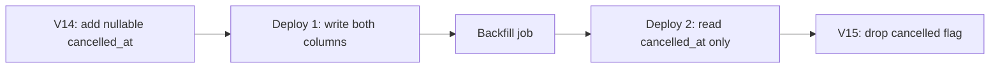

# Examples

Worked use cases for the workflow in the [README](../README.md). Each one says who does what and
which command moves the ticket on. The service, ticket ids and class names are made up.

- [The people and the agents](#the-people-and-the-agents)
- [1. A small fix (T0)](#1-a-small-fix-t0)
- [2. A feature, start to merge (T1)](#2-a-feature-start-to-merge-t1)
- [3. Answering decisions as the approver](#3-answering-decisions-as-the-approver)
- [4. A risky change with a diagram (T2)](#4-a-risky-change-with-a-diagram-t2)
- [5. The plan turns out to be wrong](#5-the-plan-turns-out-to-be-wrong)
- [6. A review finding only a human can settle](#6-a-review-finding-only-a-human-can-settle)
- [7. Waiting on another team](#7-waiting-on-another-team)
- [8. Picking a ticket up again](#8-picking-a-ticket-up-again)
- [When a gate says no](#when-a-gate-says-no)

## The people and the agents

| Role | Who | Does |
| --- | --- | --- |
| Driver | the developer running Copilot CLI | Starts the ticket, hands work to the agents, accepts each slice |
| Approver | another human | Answers the decisions, dispositions the objections, approves the plan and later the diff on GitHub |
| `scout` | agent | Reads the code and the ticket, proposes a tier. Writes nothing. |
| `architect` | agent | Writes `plan.md` |
| `reviewer` | agent | Challenges the plan, then reviews the diff, in `review.md` |
| `implementer` | agent | Builds one slice at a time, inside that slice's paths |

You hand work to an agent by naming it in your prompt, for example
`Use the scout agent to triage ORD-142: <ticket text>`.

## 1. A small fix (T0)

**Use it when** the change is a narrow bug fix or a mechanical refactor that touches none of the
tier path rules.

```bash
./agentwf start ORD-150 --tier T0      # branch ORD-150 and a ticket folder with a task note
```

Fill the three sections of `docs/agent-work/ORD-150/plan.md`, or ask the architect to:

```markdown
## Goal
`OrderMapper.toDto` drops the currency when the amount is zero. Expected: currency is always set.
Reproduced by `OrderMapperTest.zeroAmountKeepsCurrency` (new, failing).

## Files
`src/main/java/com/acme/orders/OrderMapper.java`, `src/test/java/com/acme/orders/OrderMapperTest.java`

## Checks
`./gradlew test --tests '*OrderMapperTest'`
```

Make the change, commit, open a pull request. There are no slices, no decision list and no plan
approval; normal PR review covers the diff.

If the fix turns out to touch a migration or security configuration, `./agentwf tier` shows the
higher floor and the hook refuses the write. Start again at that tier; only a human lowers one.

## 2. A feature, start to merge (T1)

**The ticket:** ORD-142, customers can cancel an order that has not shipped.

### Triage and plan (driver, scout, architect, reviewer)

```bash
# In Copilot CLI: "Use the scout agent to triage ORD-142: <ticket text>"  ->  proposes T1
./agentwf start ORD-142 --tier T1
# "Use the architect agent to write the plan for ORD-142"
# "Use the reviewer agent to challenge the plan"
./agentwf check                        # lists what the plan still lacks
```

The plan the architect writes looks like this. The IDs are what the gates read: every `R-nn` needs
a scenario, every `SC-nn` a named test, every slice its paths, every decision a recommendation.

````markdown
---
ticket: ORD-142
tier: T1
plan_version: 1
base_commit: 4be1c07
---

# Plan: ORD-142

## Problem and outcome

Customers call support to cancel orders. They should cancel an unshipped order themselves.
Out of scope: refunds (handled by billing on the existing `OrderCancelled` event).

## Requirements

- R-01: The owner of an order can cancel it while its status is `PLACED` or `PAID`.
- R-02: A shipped order cannot be cancelled; the response is 409.
- R-03: Another customer's order is reported as 404, never 403.

## Scenarios and API contract

`POST /orders/{id}/cancel`, authenticated customer, no body. Errors use the service's
`application/problem+json` format (`GlobalExceptionHandler.java:31`).

| ID | Scenario | Covers | Expected result |
| --- | --- | --- | --- |
| SC-01 | Owner cancels a `PAID` order | R-01 | 200, status `CANCELLED`, `OrderCancelled` published |
| SC-02 | Owner cancels a `SHIPPED` order | R-02 | 409 `order-not-cancellable` |
| SC-03 | Customer cancels someone else's order | R-03 | 404 `order-not-found` |

## Design

Today only `OrderAdminController.java:58` can cancel, through `OrderService.cancel`
(`OrderService.java:112`), which does not check the status. Proposed: a customer endpoint that
calls the same method, which gains the status check.

### Change map

| File | Change | Reason |
| --- | --- | --- |
| `src/main/java/com/acme/orders/OrderService.java` | status check in `cancel` | R-01, R-02 |
| `src/main/java/com/acme/orders/OrderController.java` | new endpoint, owner lookup | R-01, R-03 |
| `README.md` | endpoint list | made stale by the change |

## Test matrix

| Scenario | Level | Test |
| --- | --- | --- |
| SC-01 | Integration | OrderCancelIT.ownerCancelsPaidOrder |
| SC-02 | Unit | OrderServiceTest.shippedOrderIsNotCancellable |
| SC-03 | Web slice | OrderControllerTest.otherCustomersOrderIsNotFound |

## Slices

### S-01: status check in the service
- Covers: R-01, R-02, SC-02
- Paths: `src/main/java/com/acme/orders/OrderService.java`, `src/test/java/com/acme/orders/**`
- Tests: OrderServiceTest.shippedOrderIsNotCancellable
- Exit check: `./gradlew test --tests '*OrderServiceTest'` passes

### S-02: customer endpoint
- Covers: R-01, R-03, SC-01, SC-03
- Paths: `src/main/java/com/acme/orders/OrderController.java`, `src/test/java/com/acme/orders/**`, `README.md`
- Tests: OrderCancelIT.ownerCancelsPaidOrder, OrderControllerTest.otherCustomersOrderIsNotFound
- Exit check: `./gradlew check` passes

## Decision list

### D-01: What does cancelling an already cancelled order return?
- Why a human: it is a promise to the mobile team, who retry on timeouts
- A: 200 with the cancelled order. Retries are safe; a double tap looks like success.
- B: 409 `order-not-cancellable`. Stricter, but every client must treat 409 after a retry as success.
- Recommendation: A, because the mobile client retries POSTs on timeout (`docs/clients.md:14`)
- Reversible: yes, until the endpoint is in the published OpenAPI description
- Answer:
````

### Approve the plan (approver)

```bash
git add docs/agent-work/ORD-142 && git commit -m "ORD-142 plan" && git push -u origin ORD-142
gh pr create --draft --fill
```

The approver answers `D-01`, gives each objection in `review.md` a disposition, commits, then
submits an approving review on the draft PR. See [use case 3](#3-answering-decisions-as-the-approver).
From here `plan.md` is frozen: any edit cancels the approval.

### Implement, one slice at a time (driver, implementer)

```bash
./agentwf slice start S-01
# "Use the implementer agent to build S-01"   -> it commits with a `Slice: S-01` trailer
./agentwf slice review S-01            # the implementer runs this when its commit is in
# you read the slice's diff
./agentwf slice accept S-01            # human only
./agentwf slice start S-02             # refused until S-01 is accepted
```

While S-01 is active the hook refuses any write outside its `Paths`, so the implementer cannot
drift into the controller early.

### Review and merge (reviewer, approver)

```bash
./agentwf state IN_REVIEW
# "Use the reviewer agent to review the diff"  -> findings, the reviewed commit and a brief in review.md
./agentwf check
gh pr ready
```

The approver reads the review brief and the diff and approves on GitHub. After the merge, the
driver writes the retrospective in `log.md` and runs `./agentwf state DONE`.

## 3. Answering decisions as the approver

**Use it when** a driver asks you to approve a plan.

```bash
gh pr checkout 87
./agentwf view --open
```

The page is generated from the ticket's three markdown files and is never committed. Read it top
to bottom:

- **Needs you** lists everything waiting for a human: unanswered decisions, objections without a
  disposition, blocking questions, slices awaiting review, findings marked `decide`.
- **Decisions** shows each one as a card: the options with their consequences, why it is yours,
  the recommendation and its rationale, and whether you can change your mind later.
- **Trace** draws requirement → scenario → test. A red dashed box is a requirement nothing covers
  or a scenario nothing tests.
- **Slices** shows which slice may write each file in the change map.

Pick an option on each card, add a note if you want one on record, and press **Copy commands**:

```bash
./agentwf answer D-01 A 'agreed with mobile on 2026-11-12'
```

Editing the `- Answer:` line by hand, or in GitHub's web editor, does the same thing. An answer
does not have to be one of the letters: `./agentwf answer D-01 neither, see Q-02` is recorded as
written. Then:

1. In `review.md`, write `accepted`, `rejected` (with a reason) or `deferred` (to a named person)
   for each objection.
2. Commit and push both files.
3. Submit an approving review on the PR. Approve after the commit: the approval is tied to the
   exact `plan.md` you reviewed.

`./agentwf check` passes the `structure` gate once every decision and objection is settled.

## 4. A risky change with a diagram (T2)

**Use it when** the work touches a path rule: a database migration, security configuration, CI or
deployment files, or a breaking API change. `./agentwf tier` reports the floor; the scout cannot go
below it.

A T2 plan adds two things to use case 2:

- an `## Alternatives` section with at least one real alternative and why it lost, and
- a Mermaid diagram wherever a trigger in the template applies. Here the steps must happen in an
  order across two deploys, so the architect draws the order:

````markdown
## Data and migration



Rollback is safe up to and including the backfill. After V15 the fix is forward only.
````

GitHub renders the diagram in the PR, and `./agentwf view` renders it next to the decisions. The
other triggers are a flow across more than two components (sequence diagram) and a new or changed
state transition (state diagram). The trace and the slice map are generated for you; nobody draws
those by hand.

## 5. The plan turns out to be wrong

**Use it when** the implementer finds that the code does not match what the plan assumed. In S-02
it discovers that `OrderController` has no access to the customer id the plan relies on.

The implementer stops and logs it; it does not improvise:

```
- 2026-11-14 mismatch S-02: OrderController gets no customer id; AuthContext is only wired into the admin API
```

Then:

```bash
./agentwf state PLANNING "mismatch S-02"
# "Use the architect agent to revise the plan for the S-02 mismatch"
```

The architect edits `plan.md`, raises `plan_version` and logs why. The edit cancels the approval,
so the hook blocks source edits again until the approver has approved the new version. Slices
already accepted stay accepted.

## 6. A review finding only a human can settle

**Use it when** the diff review reports a finding with action `decide`.

The reviewer marks each finding `fix` (one correct fix that changes no planned behaviour; the
implementer applies it) or `decide`:

```markdown
| ID | Severity | File:line | Failure scenario | Recommended fix | Type | Action | Status |
| --- | --- | --- | --- | --- | --- | --- | --- |
| F-01 | high | `OrderService.java:118` | Two concurrent cancels both publish `OrderCancelled` | Optimistic lock on `Order.version` | defect | fix | open |
| F-02 | medium | `OrderController.java:74` | A cancel by support staff is rejected as "not the owner" | Allow the `SUPPORT` role | question | decide | open |
```

`F-02` appears under **Needs you** in `./agentwf view`. A human replaces `open` in its Status cell
with `fix` or `won't fix: support uses the admin API`. For the fixes, the driver restarts the slice
with `./agentwf slice start S-02`. After two fix rounds the open findings go to the human rather
than round a third time.

## 7. Waiting on another team

**Use it when** the plan depends on something nobody in the room can answer. The architect records
it instead of guessing:

```markdown
## Open questions

| ID | Question | Owner | Blocking | Answer source | Status |
| --- | --- | --- | --- | --- | --- |
| Q-01 | Does billing refund on `OrderCancelled` for partially paid orders? | Priya (billing) | yes | | open |
```

```bash
./agentwf state BLOCKED "Q-01, waiting on Priya (billing)"
```

The `structure` gate fails while a blocking question is open. When the answer arrives, set the
status to `answered` with its source, or the approver writes `risk-accepted`, and move on with
`./agentwf state PLANNING`.

## 8. Picking a ticket up again

**Use it when** you, a colleague or a new agent session comes back to a branch.

```bash
git switch ORD-142
./agentwf status
```

```
ticket        ORD-142
state         IMPLEMENTING
tier          T1   plan version 1
plan approval yes
slice S-01    accepted
slice S-02    awaiting-review

next: review S-02, then `./agentwf slice accept S-02` (or `./agentwf slice start S-02` for a fix round)
```

The ticket folder is the memory, not the chat. `./agentwf view --open` gives the same picture with
the decisions and their answers, which is the quickest way to learn why the code looks the way it
does.

## When a gate says no

| Message contains | What it means | What to do |
| --- | --- | --- |
| `ticket` | A source edit with no ticket folder for this branch | `./agentwf start <id> --tier ...` on a branch named after the ticket |
| `plan-approval` | No approving review covers the current `plan.md` | Commit the plan, open a draft PR, ask the approver. If you edited the plan after approval, it needs approving again. |
| `slice-paths` | A write outside the active slice's `Paths` | Wrong slice, or the plan missed a file: see [use case 5](#5-the-plan-turns-out-to-be-wrong) |
| `tier-floor` | The files touched need a higher tier than the plan declares | Raise the tier in `plan.md` and plan to that tier |
| `slice-size` | A slice changed more production lines than the cap | Split the slice in the plan |
| `structure` | The plan or the review is incomplete | `./agentwf check` lists each item; `./agentwf view` shows the ones that need a human |
| `review` | The diff was not reviewed, or the code changed after the review | Run the reviewer again on the current commit |
| `dangerous-action` | An agent tried a human-only or destructive command | Run it yourself if it is right; this gate has no override |

A human can override the other gates with a reason (`./agentwf override <gate> <reason>`); every
override is read in the retrospective. Agents never look for a way around a gate.
